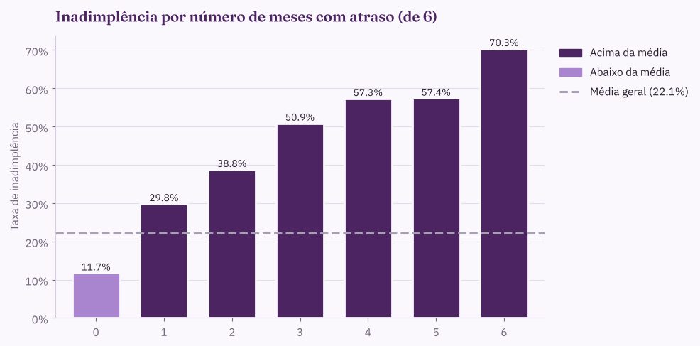
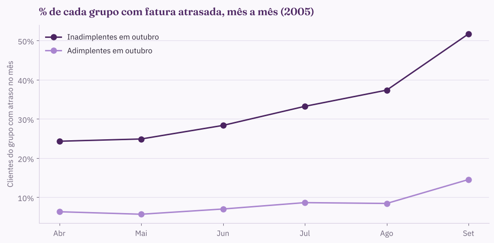
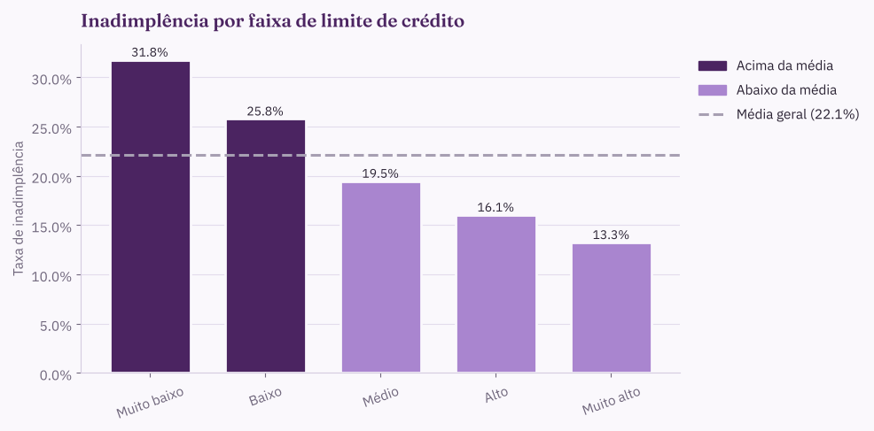
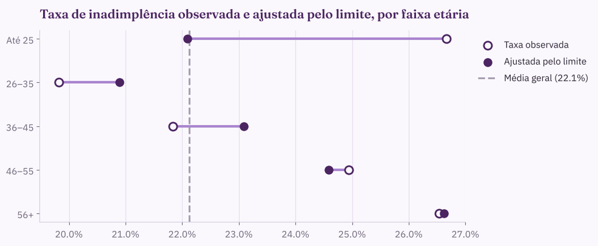
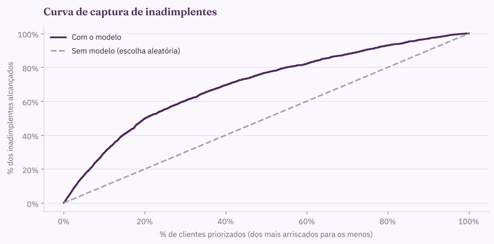

# Análise de inadimplência em cartões de crédito

O comportamento de pagamento diz muito sobre o risco de inadimplência e sobre o perfil de cada cliente. Este projeto
mostra o quanto, e como um modelo simples ajuda o banco a prever a inadimplência e a delimitar a concessão de crédito.

**[Ver o dashboard](https://juliaragibeltrao.github.io/Analise-de-Inadimplencia/)** ·
**[Ler a análise completa](https://juliaragibeltrao.github.io/Analise-de-Inadimplencia/relatorio.html)** ·
**[Notebook](notebooks/analise_inadimplencia.ipynb)**

**Ferramentas:** Python · pandas · matplotlib · scikit-learn · Google Colab

---

## O problema

Um banco emissor de cartões quer identificar, com antecedência, quais clientes vão deixar de pagar a fatura, para agir
antes da perda sem prejudicar os bons clientes.

O dataset reúne **30 mil clientes** de um banco de Taiwan, com dados cadastrais, limite de crédito e **6 meses de
histórico** (abril a setembro de 2005) de faturas, pagamentos e atrasos. O objetivo é prever quem ficará inadimplente
no mês seguinte (outubro).

## Principais resultados

| Número | O que significa |
|---|---|
| **22,1%** | dos clientes ficaram inadimplentes no mês seguinte ao histórico |
| **70,3%** | de inadimplência entre quem atrasou nos 6 meses, contra 11,7% de quem nunca atrasou |
| **0,755** | de AUC no modelo de regressão logística |
| **49,7%** | dos inadimplentes estão entre os 20% de clientes que o modelo aponta como mais arriscados |

**1. O histórico de atrasos é o sinal mais forte.** A inadimplência sobe a cada mês de atraso acumulado.



**2. O sinal aparece meses antes.** Em abril, 24,3% dos clientes que ficariam inadimplentes em outubro já tinham fatura
atrasada, contra 6,3% dos que pagaram.



**3. Limites baixos concentram mais risco:** 31,8% de inadimplência em limites de até NT$ 50 mil, contra 13,3% acima
de NT$ 300 mil.



**4. O risco maior dos jovens vem do limite, não da idade.** Clientes de até 25 anos têm a maior taxa (26,7%), mas
recebem limites bem menores. Ajustando pelo limite, a taxa deles fica igual à média geral (22,1%).



**5. Um modelo simples prioriza bem os clientes de risco.** Agindo sobre os 20% de clientes com maior risco, o banco
alcança 49,7% dos inadimplentes e 52,5% do saldo em risco. Sem o modelo, alcançaria 20%.



## Recomendações

1. **Cobrança preventiva no primeiro mês de atraso:** clientes com 1 mês de atraso já têm 33,9% de inadimplência
   (1,5 vez a média).
2. **Priorização pelo modelo:** concentrar cobrança e revisão de limite nos 20% de clientes de maior risco.
3. **Renegociação** para quem paga menos de 10% da fatura (27,5% de inadimplência), antes que o atraso aconteça.

## Metodologia

1. **Preparação dos dados:** tratamento de categorias não documentadas, correção de nomes de colunas e interpretação
   dos códigos de pagamento.
2. **Criação de variáveis:** uso do limite, meses em atraso, status do último mês e percentual da fatura paga.
3. **Análise exploratória:** taxa de inadimplência por grupo e risco em relação à média, incluindo uma análise de
   variável de confusão (idade × limite) com padronização direta.
4. **Modelo:** regressão logística com divisão treino/teste (70/30) e `class_weight='balanced'`, comparada com uma
   Random Forest (AUC 0,774). A regressão logística foi mantida por ser mais fácil de explicar à área de negócio e a
   órgãos reguladores. Sexo e estado civil foram excluídos do modelo por questões éticas e regulatórias.
5. **Impacto no negócio:** curva de captura e parcela do saldo em risco coberta.

## Limitações e próximos passos

- Dados de 2005, de um único banco de Taiwan: os padrões podem não valer para o Brasil hoje.
- O dataset não traz renda nem profissão, o que limita a análise de capacidade de pagamento.
- Próximos passos: calibrar as probabilidades do modelo, testar modelos de gradient boosting e definir o ponto de
  corte com base no custo de cada tipo de erro.

## Como executar

1. Abra o [notebook](notebooks/analise_inadimplencia.ipynb) no [Google Colab](https://colab.research.google.com/)
   (Arquivo → Abrir notebook → GitHub, e cole o link deste repositório).
2. Execute as células em ordem. Os dados são baixados automaticamente do UCI Machine Learning Repository.

Para rodar localmente:

```bash
pip install -r requirements.txt
jupyter notebook notebooks/analise_inadimplencia.ipynb
```

## Estrutura do repositório

```
Analise-de-Inadimplencia/
├── README.md
├── requirements.txt
├── notebooks/
│   └── analise_inadimplencia.ipynb   # análise completa, já executada
├── images/                           # gráficos usados neste README
└── docs/                             # páginas publicadas no GitHub Pages
    ├── index.html                    # dashboard
    └── relatorio.html                # análise completa em HTML
```

## Dados

Yeh, I. (2009). *Default of Credit Card Clients* [Dataset]. UCI Machine Learning Repository.
https://doi.org/10.24432/C55S3H. Licença [CC BY 4.0](https://creativecommons.org/licenses/by/4.0/).

---

**Julia Beltrão** · Análise de dados · [GitHub](https://github.com/juliaragibeltrao)
